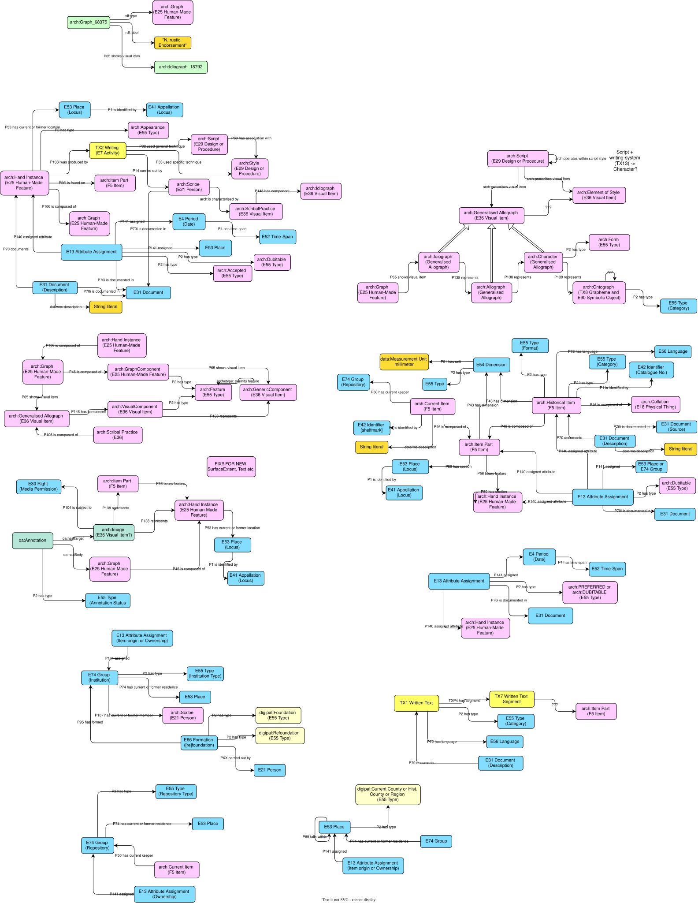

# Archetype ontology, mapping and RDF export

Project to map the [Archetype 2](https://github.com/kcl-ddh/digipal) (pre-2026) data model to a formal ontology based on CIDOC-CRM, and to export data with RDF.

First stage completed by Eve Grimaud (CESR, Université de Tours), under the supervision of Peter A. Stokes, [AOROC (UMR 8546)](https://archeo.ens.fr), [École Pratique des Hautes Études, Université PSL](https://ephe.psl.eu).
Subsequent revisions and further work by Peter Stokes.

The export has been developed primarily for [DigiPal project](https://digipal.eu), but also with some testing on the palaeographical part of [Models of Authority](https://modelsofauthority.ac.uk). Note however that **the Archetype 2 text app is not yet implemented**.

This repository builds on but entirely replaces the [Archetype-Ontology repository](https://github.com/pastokes/archetype-ontology); the latter model should now be considered obsolete.

This work was completed in the context of [Biblissima+ Cluster 4](https://projet.biblissima.fr/fr/projet/clusters-biblissima/cluster-4). The work benefited from financial support from the French state managed by the Agence Nationale de Recherche under the Programme d'investissements d'avenir integrated into France 2030, with grant no. ANR-21-ESRE-0005.

## Structure

- **archetype_ontology.ttl** gives the ontology in OWL format
- **archetype_shapes.ttl** provides further definition of the model using SHACKL shapes
- **scripts**: Python scripts and related files for generating the SHACKL shapes and the RDF export from an Archetype instance.
- **reports**: Reports detailing the full process and decision-making behind the ontology, export and SHACKL shapes in their current state.
- **schema**: Local copies of external ontologies (CIDOC-CRM, CRMtex, etc.). These are unchanged and saved here for purely for archival purposes.
- **logos**: Local copies of logos for the README.md

Note that the actual RDF exports are not stored in the GitHub repository but will be posted on Zenodo as related projects.

All reports (i.e. `reports/*.md`) and also the scripts relevant to shape generation (`scripts/harvest_edges.py` and `scripts/gen_shapes.py`) were auto-generated. The resulting SHACKL shape file has been carefully checked, but other auto-generated files should be used with caution. The reports and script comments in particular may contain inconsistencies.

The export script (`creation_rdf.py`) was written by hand and checked repeatedly, by hand and with the help of tools and automated processes, and the resulting RDF has also been checked automatically for consistency and via manual spot-checks against the original data. The model diagram has been generated entirely by hand from the ontology and SHACKL files. However, this is still a work in progress and inconsistencies remain likely. Issues and 'todos' are flagged in the code and reports, but GitHub Issues are extremely welcome.

---

&nbsp;&nbsp;&nbsp;&nbsp;

&nbsp;&nbsp;&nbsp;&nbsp;

---
# Model diagram

