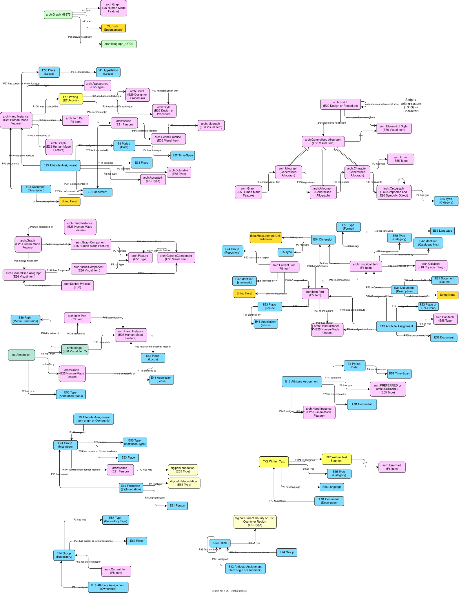

# Archetype ontology, mapping and RDF export

Project to map the [original (v2) Archetype](https://github.com/kcl-ddh/digipal) data model to a formal ontology based on CIDOC-CRM, and to export data with RDF, building on but entirely replacing the [Archetype-Ontology repository](https://github.com/pastokes/archetype-ontology).

First stage completed by Eve Grimaud (CESR, Université de Tours), under the supervision of Peter A. Stokes, [AOROC (UMR 8546)](https://archeo.ens.fr), [École Pratique des Hautes Études, Université PSL](https://ephe.psl.eu).
Subsequent revisions and further work by Peter Stokes.

The export has been developed primarily for [DigiPal project](https://digipal.eu), but also with some testing on the palaeographical part of [Models of Authority](https://modelsofauthority.ac.uk). Note however that **the text part of Archetype is not yet implemented**.

This work was completed in the context of [Biblissima+ Cluster 4](https://projet.biblissima.fr/fr/projet/clusters-biblissima/cluster-4). The work benefited from financial support from the French state managed by the Agence Nationale de Recherche under the Programme d'investissements d'avenir integrated into France 2030, with grant no. ANR-21-ESRE-0005.

&nbsp;&nbsp;&nbsp;&nbsp;

&nbsp;&nbsp;&nbsp;&nbsp;

---
# Model diagram

